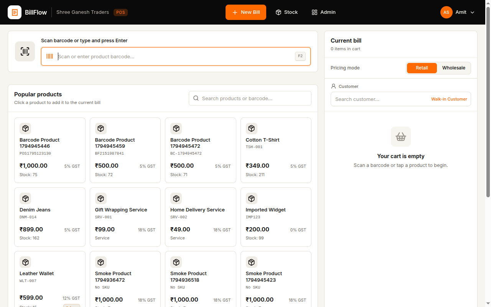

# BillFlow — billing, CRM & business analytics

BillFlow is a billing-first point-of-sale and business management app for small
and medium businesses. The primary application is a **React + TypeScript web
app** backed by **FastAPI + PostgreSQL**. An optional **Tauri 2** shell can
package the same frontend as a native Linux/Windows desktop app without
bundling Chromium.



## Architecture

| Path | Role |
| --- | --- |
| `frontend/` | React + TypeScript + Vite UI — the visual source of truth |
| `backend/` | FastAPI application: REST APIs, business logic, SQLAlchemy models, PostgreSQL |
| `src-tauri/` | Optional Tauri 2 native shell (Rust commands, config, capabilities, icons) |
| `shared/` | `billflow-shared` Rust library used by the Tauri shell for local SQLite operations |
| `desktop/` | Earlier egui prototype, retained for reference but not built |
| `linux-app/`, `windows-app/` | Tauri build scripts and packaging for Linux/Windows |
| `mcp-server/` | Separate Product Discovery MCP server for external AI assistants |
| `assets/` | Source and generated app icons (also used as the web favicon) |

## Features

- **Billing-first POS** — search or scan products, cart with quantity/discount
  controls, retail/wholesale pricing switch, GST totals and a two-tab checkout
  (UPI QR / cash).
- **USB barcode scanners** — keyboard-wedge scanner support: continuous
  scanning, Enter suffix handling, and focus management even when another field
  has focus.
- **Barcode Sticker Studio** — product selection with per-product quantities,
  40×25 mm default package-ready labels, A4 sticker sheets and individual-size
  printing, with genuine Code 128 / EAN 13 barcodes.
- **Inventory & product onboarding** — products, SKUs, barcodes, stock,
  low-stock alerts, CSV/Excel import, photo/PDF OCR, and an AI-assisted
  catalogue prompt generator.
- **Suppliers** — user-defined categories, supplier-product links, purchase
  reminders, visit history, active/deactivated states and safe purchase
  conversion through the existing inventory flow.
- **Customers & analytics** — profiles and purchase history, sales trends,
  collections, growth, payment-method breakdown and CSV reports.
- **Payments & audit** — cash/UPI confirmation, UPI QR with amount and
  transaction reference, roles (owner/staff) and an activity log.

## Quick start (web app)

Requires Python 3.12+, Node/npm and PostgreSQL.

```bash
# Database (if you do not already have one)
docker run -d --name billing-db \
  -e POSTGRES_USER=billing -e POSTGRES_PASSWORD=billing_dev_pass \
  -e POSTGRES_DB=billing -p 5433:5432 postgres:16-alpine

# Backend
cd backend
python3 -m venv .venv && source .venv/bin/activate
pip install -r requirements.txt
python seed.py                      # demo data, optional
uvicorn app.main:app --host 0.0.0.0 --port 8000 --reload

# Frontend (another terminal)
cd frontend
npm install
npm run dev                         # http://localhost:5173
```

Demo login: `demo@billingapp.com` / `Demo@1234` (staff:
`staff@billingapp.com` / `Staff@1234`). API docs: <http://localhost:8000/docs>.

## Optional desktop build (Tauri 2)

From the repository root:

```bash
npm install
npm run tauri:dev       # development window
npm run tauri:build     # installers in src-tauri/target/release/bundle/
```

See the [Linux build](linux-app/README.md), [Windows build](windows-app/README.md)
and their packaging notes. Tauri uses WebKit2GTK on Linux and WebView2 on
Windows; no Node, Python or browser runtime is bundled.

## Product Discovery MCP server

[`mcp-server/`](mcp-server/README.md) is a separate, read-only MCP server that
helps external AI assistants find real products and verified manufacturer
barcodes. It never manages BillFlow inventory or business data.

## Data model

- **PostgreSQL** is the centralized store for the web app. All business data is
  tenant-scoped by `business_id`.
- **Local SQLite** is used by the Tauri shell for offline/native operations,
  backups and restore; it is not a parallel product catalogue.
- Credentials and privileged native operations stay in Rust when using Tauri;
  the frontend never handles database secrets.

## Tests

```bash
cd backend && .venv/bin/python -m unittest discover -s tests
cd frontend && npm run build
```
